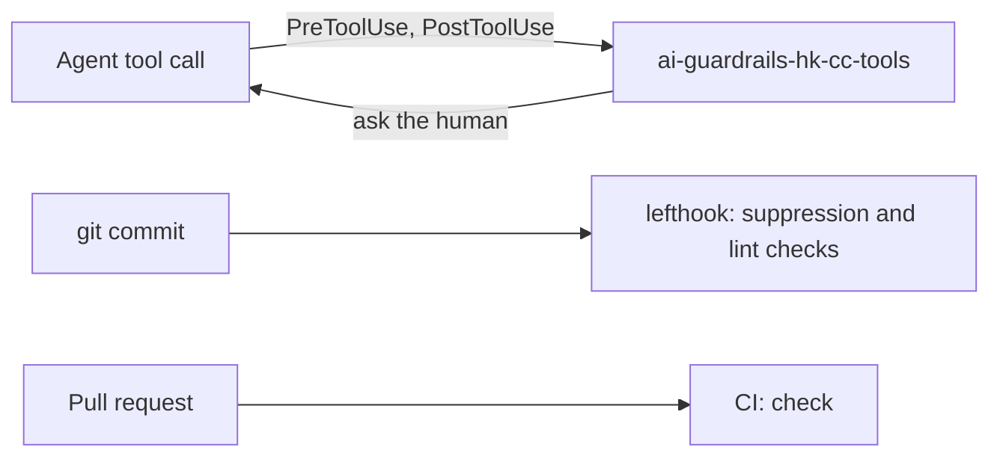

<div align="center">

# `ai-guardrails`

**Lint, hook and CI checks that flag when a coding agent weakens the project's own rules, for Claude Code on Bun.**

[](https://www.npmjs.com/package/@questi0nm4rk/ai-guardrails)
[](https://github.com/Questi0nM4rk/ai-guardrails/actions/workflows/check.yml)
[](https://github.com/Questi0nM4rk/ai-guardrails/actions/workflows/check.yml)
[](https://github.com/Questi0nM4rk/ai-guardrails/actions/workflows/check.yml)
[](https://github.com/Questi0nM4rk/ai-guardrails/actions/workflows/check.yml)
[](./LICENSE)
[](https://github.com/Questi0nM4rk/ai-guardrails/releases)

</div>

```console
$ echo '{"hook_event_name":"PreToolUse","session_id":"t","cwd":"/tmp","transcript_path":"/tmp/x",
         "tool_name":"Bash","tool_input":{"command":"git push --force origin main"}}' \
    | HOOK_KIT_ASKPASS= ai-guardrails-hk-cc-tools
{"hookSpecificOutput":{"hookEventName":"PreToolUse","permissionDecision":"ask","permissionDecisionReason":"[ai-guardrails] git push --force"}}
```

## Why it exists

Coding agents add `# noqa` or `@ts-ignore` to make CI pass, edit the lint config until their code is clean, and run `git push --force`.
A rule in `CLAUDE.md` is a request, and nothing notices when the agent ignores it.
This project puts checks in three places: the agent's tool calls, the commit, and CI.
It refuses to be an AI reviewer: every check is a deterministic rule, and none calls a model.
It would have no reason to exist once agents reliably keep to written rules, or once Claude Code enforces them itself.

## Quickstart

The build and tests run on Bun (`engines` in `package.json` says Node 18+).

```bash
bun install && bun run build:all
printf '%s' '{"hook_event_name":"PreToolUse","session_id":"t","cwd":"/tmp","transcript_path":"/tmp/x",'\
  '"tool_name":"Bash","tool_input":{"command":"rm -rf /"}}' \
  | HOOK_KIT_ASKPASS= ./dist/ai-guardrails-hk-cc-tools
bun test
```

Expected output of the second command:

```text
{"hookSpecificOutput":{"hookEventName":"PreToolUse","permissionDecision":"ask","permissionDecisionReason":"[ai-guardrails] rm with --recursive and --force flags"}}
```

The summary printed by `bun test` includes `0 fail`. The end-to-end tests need the build first.

`bun run lint` and `bun run typecheck` are the other two gates. `./dist/ai-guardrails check` on this repo exits 1 today because `shfmt` wants `scripts/install.sh` reformatted.
To use it in a project, install the binaries with `scripts/install.sh` and run `ai-guardrails init` there. See [docs/guide.md](docs/guide.md).

## How it works



1. **Agent hooks.** Claude Code runs `ai-guardrails-hk-cc-tools` before Bash, Edit, Write and Read calls, and after Edit and Write calls.
Before a call, it parses shell commands into an AST and answers `ask` for dangerous ones, so the human decides.
After an edit, it looks for suppression comments the edit added.
2. **Commit hooks.** `init` wires lefthook to look for suppression comments and run the linters. Only issues new since the baseline fail.
3. **CI.** The workflow `init` generates runs `check`. `generate --check` can verify the generated configs in CI, but no workflow in this repo calls it yet.

It is built on [hook-kit](https://github.com/Questi0nM4rk/hook-kit) (the hook binary) and [shell-ast](https://github.com/Questi0nM4rk/shell-ast) (the command parser).

Everything is deterministic. No part calls a model.
Generated config files carry a SHA-256 header. Only `generate --check` compares it.
The hash has no key, so anyone who edits a file can recompute it, and a file without a header is not checked. Details in [docs/guide.md](docs/guide.md#config-tamper-detection).

## Numbers

[](https://github.com/Questi0nM4rk/ai-guardrails/actions/workflows/check.yml)
[](https://github.com/Questi0nM4rk/ai-guardrails/actions/workflows/check.yml)
[](https://github.com/Questi0nM4rk/ai-guardrails/actions/workflows/check.yml)

| What | How to measure |
| --- | --- |
| Tests | `bun test` |
| Dangerous commands flagged | `bun run build:hk-cc`, then `bun bench/hook-corpus.ts`; misses listed in [bench/RESULTS.md](bench/RESULTS.md) |
| False asks on benign inputs | same run as dangerous commands flagged |
| Source size | `scc src` |
| Test size | `scc tests` |
| `ai-guardrails` binary size | `stat -c %s dist/ai-guardrails` |
| Hook binary size | `stat -c %s dist/ai-guardrails-hk-cc-tools` |
| Hook latency | Not measured |

Commits include agent-authored work under my identity; design, orchestration and review are mine.

## Status

- **Works:** `init`, `check`, `snapshot`, `generate --check`, the Claude Code hook binary, suppression comment detection.
- **Experimental:** the editor and reviewer files `init` can write (Helix, Zed, Neovim, CodeRabbit). I did not run them today.
- **Tried and dropped:** the first versions were bash scripts, then a Python installer (pyinfra); the project was rewritten in TypeScript.
  A regex matcher for dangerous commands was replaced by a shell AST.
  A hard-coded `permissions.deny` list was dropped because it disagreed with the hook.
- **Known gaps:**
  - Tamper detection is weak, see above. The hook rule that guards managed files (`ai-guardrails write protection`) asks the human before it writes a managed file, and that is the stronger barrier.
  - Hook decisions are `ask`, not `deny`. A human who always answers yes gets no protection.
  - The hook reads the command text. On a labelled corpus of dangerous inputs it misses some (live counts in the badges under Numbers; table in [bench/RESULTS.md](bench/RESULTS.md), labels in [bench/corpus.jsonl](bench/corpus.jsonl)).
    The misses: `rm -rf` behind a wrapper or spelling (`env`, `command`, `nohup`, `xargs`, an absolute path, quoting, `$(echo rm)`), `git push` with `-C`, an absolute path or a `+refspec`, hook bypass through `-c core.hooksPath` or `HUSKY=0`, a remote script run through `bash <(curl ...)`, `$(curl ...)` or a downloaded file, `git stash drop`, `git reflog expire`, reading `.env` or `~/.ssh/id_rsa` with `cat`, and one `@ts-expect-error` suppression.
    The corpus is mine and small, and I wrote the labels before the first run; it measures this hook, not agents in general.
    [docs/bugs/hook-bypass-regex-limitations.md](docs/bugs/hook-bypass-regex-limitations.md) lists the bypasses of the old regex matcher and marks them fixed by the AST engine.
  - A runner whose tool is not installed (ruff, clang-tidy, selene, pyright) is skipped with a message.
  - `check` on a trivial project can report a Biome schema warning from the generated `biome.jsonc` (seen once, version mismatch).
  - One test failed in one of about four runs before, and I could not name it. Not seen in the later runs.
  - `docs/plans/` and `docs/BUGS.md` are working notes and are not kept current.

## License

GPL-3.0.

Releases published before 2026-10-12 remain available under MIT.
